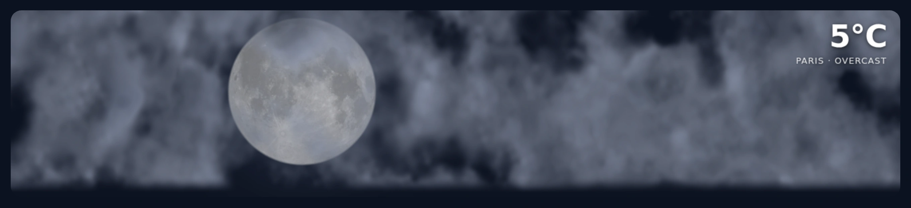
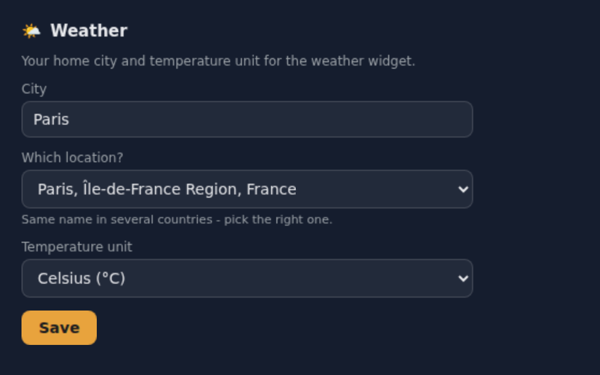
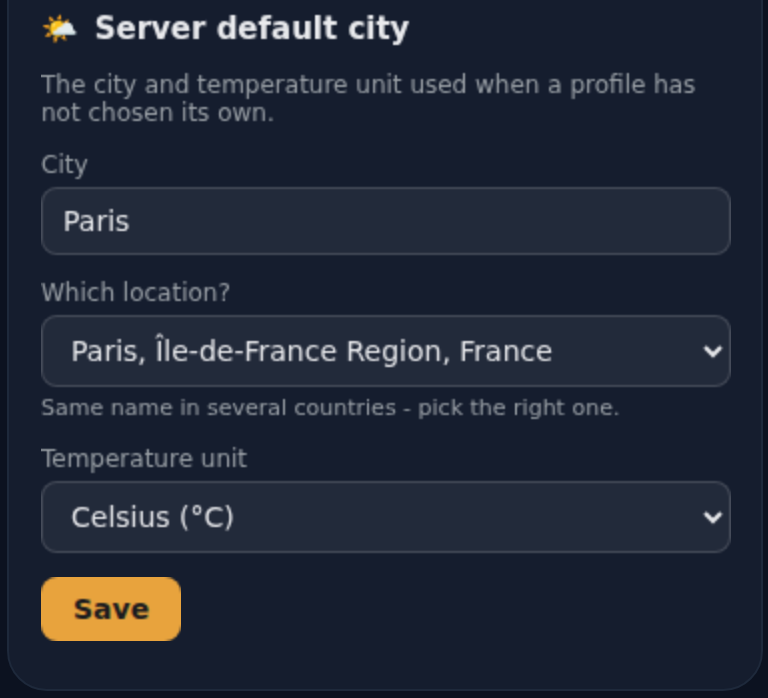

# 🌤️ Weather

**The weather where you live, on your Evey home screen, behind a sky that matches it.**



## What it does

- 🌡️ **Today's weather on the home screen**: the temperature, your city and the sky.
- ☁️ **A sky that matches**: sun, clouds, rain, snow, fog, thunder.
- 🌙 **The real sun and moon**: NASA photos, the moon in its actual phase tonight, the sun rising and setting at the real times.
- 👨‍👩‍👧 **Everyone their own city**: each profile picks its city and its unit (°C or °F).
- 📺 **Everywhere**: web, phone and TV.

## Install

1. In Evey, open **Admin > Plugins** and click **Install Plugin**.
2. Choose **From URL** and paste `https://github.com/eveyproject/evey-plugin-weather`.
3. The preview says it is **Signed by Evey project**. Click **Install**.

The weather shows up on everyone's home screen right away, for Paris until you set a city.

> Needs Evey **0.1.10** or later.

## Settings

### Your own city (each profile)

Open **Settings > Plugins**. Type your city, pick the right one in the list (the list gives the region and country, so *Brest, France* and *Brest, Belarus* are not confused), choose °C or °F, and **Save**.



### The default city (administrator)

A profile that has not picked a city uses the server's default. Set it in **Admin > Plugins**, on the Weather card, with **Config**: the same picker.



| Setting | What it changes | Default |
|---|---|---|
| City | the place the weather is for | Paris |
| Temperature unit | °C or °F | °C |

## What it can see and do

| | |
|---|---|
| ✅ Stores | each profile's city and unit, inside Evey |
| ✅ Connects to | `open-meteo.com` (forecast and city search) and NASA's `sdo.gsfc.nasa.gov` (the day's picture of the sun), nothing else |
| ❌ Never | reads your library, your account or what you watch |

Evey enforces that list: the plugin cannot reach any other address.

## Questions

**It shows the wrong Brest / Valencia / Paris.** Open the picker again and choose the right line in **Which location?**: each one shows its region and country.

**Can I hide it for one profile?** Yes, with **Customize** at the top of the home screen.

<details>
<summary><b>For developers</b></summary>

### Permissions and slots

- `network`, limited to `api.open-meteo.com`, `geocoding-api.open-meteo.com` and `sdo.gsfc.nasa.gov`.
- `prefs`: each profile's city and units.
- Slots: `home.section` (the widget), `settings.user.appearance` (each profile's city picker) and `admin.plugin.config` (the server's default city, same picker).

### Configuration storage

A picked place is stored with its coordinates, and the widget uses them as they are. Only a bare name, saved while the search could not answer, is geocoded by the widget, which then takes Open-Meteo's first match.

| Key     | Type   | Stored by                                  |
|---------|--------|--------------------------------------------|
| `city`  | string | the picker (required, defaults to Paris)   |
| `lat`   | number | the picker, empty for a bare name          |
| `lon`   | number | the picker, empty for a bare name          |
| `units` | select | `celsius` (default) or `fahrenheit`        |

The profile's choice lives in the plugin's per-profile prefs (`residence.city`, `residence.lat`, `residence.lon`, `residence.units`) and wins over the server default. The admin panel writes the server config through `evey.config.save`, which Evey checks against `config_schema`.

### Architecture (DDD, dependencies point inward)

```
src/
  domain/            pure TS, zero deps, fully unit-tested
    model/           weather.ts (snapshot, sun times), scene.ts (params, palette)
    services/        conditionToScene (WMO table), dayCycle (real solar events),
                     paletteMixer (time-of-day x mood), moonPhase,
                     location (profile pick over server default)
    ports/           WeatherProvider, HostBridge, SceneRenderer
  settings/          the city picker (SettingsApp) and its two stores:
                     a profile's prefs, or the server config
  admin/             entry of the admin.plugin.config bundle
  application/       WeatherApp: orchestration, refresh (15 min) + day-cycle
                     tick (5 s, live sun/moon motion without any page reload),
                     bounded retries, lifecycle/dispose
  adapters/          openmeteo/ (HTTP, 10 s timeout), evey/ (window.evey bridge,
                     standalone fallback), render/ (raw WebGL renderer + shader)
  ui/                vanilla-DOM overlay (no React)
  i18n/              labels en/fr/es/de
```

### Assets

Both celestial bodies are real NASA photos (public domain), bundled as small JPEGs (disc masked in-shader, no alpha needed):

- moon: NASA/GSFC FullMoon2010 (via Wikimedia Commons), 320px, 17 KB
- sun: 2 real NASA/SDO full-disc images (credit: NASA/SDO and the AIA science team), one per daily rotation skin, cropped tight so the disc fills the frame (like the moon), 384px each: AIA 171 (gold) and AIA 193 (bronze). A different one shows each UTC day (see `domain/services/sunModel.ts`); the shader keeps each skin's own tones by day and warms everything toward orange at the horizon. Disc radius is set by `SR` in the shader (~2x the moon).

These images are snapshots bundled at build time (offline-safe, no network, no CORS). Fetching the *live* "latest" SDO image per day is not possible from the sandboxed iframe: NASA serves no CORS header (WebGL texture upload would taint), and the plugin CSP restricts `img-src` to the host origin.

### Rendering

Single-pass fragment shader compositing (straight alpha over transparent canvas, host page shows through): golden-hour wash -> moon (photo texture, phase terminator) -> 2 FBM cloud layers (rim-lit toward the light source) -> thunder flash -> fog -> GPU rain/snow -> sun (disk + corona + rays, occluded per pixel by the clouds above it). ~30 fps cap, pauses when hidden or scrolled out of view, honors prefers-reduced-motion, survives WebGL context loss.

### Build and release

```sh
./scripts/build-zip.sh      # -> out/weather-<version>.zip
```

The same commit always gives the same zip, so a rebuild can be compared with a published release byte for byte. To release, bump `version` in `plugin.yaml` and push a tag `v<version>`: the workflow builds, signs with the project key and publishes `weather-<version>.zip`, its cosign signature and its sha256.

The Evey project key has the fingerprint `sha256:c29eb603b19d99a50f3fa6c94b7e92c41710779261e73e0fa31d53a78902e09a`. Compare it with the one the install preview shows before you trust it.

### Version history

- **1.1.0** - the server's default city is set in the admin with the same picker as a profile's city, and stored with its coordinates (`lat`, `lon`), so a profile that has not chosen its own city no longer gets the wrong homonym. Needs Evey 0.1.10.
- **1.0.0** - first release out of the Evey repository, under the name `weather` and signed with the Evey project key. It carries everything below.

Before 1.0.0 the plugin lived in the Evey repository as `weather-v2`:

- **2.19.0** - the package can be signed: the build ships the publisher's public key as `cosign.pub` at the ZIP root and a `.zip.sig` goes next to the ZIP, so Evey pins the publisher at install and flags a later update signed by anyone else.
- **2.15.0** - on a television the widget asks for a banner instead of a card, because a TV row is as wide as a desktop page while the panel has a fraction of the vertical room and the card height hid the library below the fold.
- **2.14.0** - live SDO frames are re-cropped to the bundled skin's tight geometry (limb at 0.93) so the shader's disc mask lines up and the edge stops looking nibbled.
- **2.13.0** - dark SDO frames are now rejected server-side (jpeg-js decode) before being persisted; the frontend pixel gate is blinded by Firefox resistFingerprinting.
- **2.12.0** - dark SDO frames (eclipse/calibration) are rejected on decoded brightness, so the sun never renders black.
- **2.11.0** - the sun-image fetch now goes through the host Fetch broker (no direct plugin network access).
- **2.10.0** - disambiguated city picker (region + country, stores coordinates) so homonyms like Brest FR/BY resolve correctly.

</details>

## License

MIT, see [LICENSE](LICENSE).
